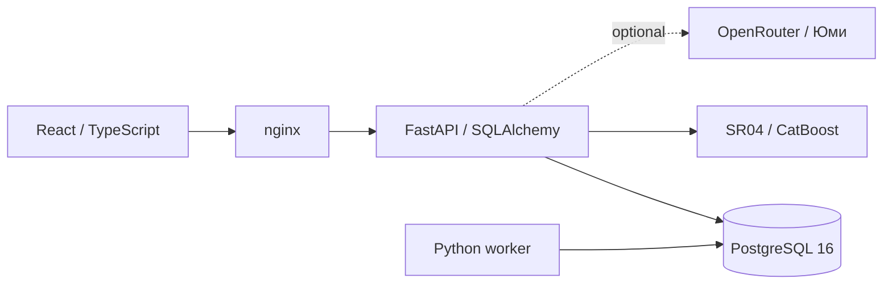

# CashCast

**Прогноз денег и предупреждения о кассовых разрывах. Команда «Нейролептик».**

CashCast принимает банковскую выписку, строит прогноз поступлений, списаний и
остатка, помогает проверить плановые платежи и сравнить сценарии. Юми — отдельный
ИИ-ассистент: отвечает по данным кабинета, показывает таблицы и графики, предлагает
изменения с обязательным подтверждением пользователя.

## Быстрый запуск: приложение и модель на одном компьютере

Нужны Git и Docker Compose v2. На Windows включите Linux containers в Docker Desktop.
Python, Node, GPU и ключ внешнего API для прогноза не нужны. Для локального демо
рекомендуется 4 CPU и 8 ГБ RAM, доступные Docker; это ориентир, не измеренный минимум.

```bash
git clone https://github.com/kirit0zxc/cashcast.git
cd cashcast
git switch main
```

Создайте файл настроек (он исключён из Git):

```powershell
# Windows / PowerShell
Copy-Item infra/.env.example infra/.env
```

```bash
# Linux / macOS
cp infra/.env.example infra/.env
```

Запустите **оба** Compose-файла, чтобы включить новую модель как на стенде:

```bash
docker compose --env-file infra/.env -f infra/docker-compose.yml -f infra/compose.risk-ml.yml up -d --build
docker compose --env-file infra/.env -f infra/docker-compose.yml -f infra/compose.risk-ml.yml ps -a
```

Откройте **http://localhost:8080**. Локальный демо-вход:
**demo@example.com / demo-password**. Для другой учётной записи измените
`CC_DEMO_EMAIL` и `CC_DEMO_PASSWORD` до первого запуска. Seed создаёт пользователя
только при его отсутствии: смена env не меняет пароль уже созданной учётной записи.

Первая сборка скачивает зависимости. `migrate` должен завершиться с кодом 0;
`api`, `worker`, `web`, `postgres` и `risk-ml` должны работать. База сохраняется в Docker volume.

```bash
curl --fail http://localhost:8080/api/v1/health
docker compose --env-file infra/.env -f infra/docker-compose.yml -f infra/compose.risk-ml.yml exec -T risk-ml python /app/smoke.py
```

В PowerShell при необходимости используйте `curl.exe`. Вторая команда проверяет
реальные веса и ответы «да/нет» на искусственных данных; это проверка запуска,
а не измерение точности. Остановка с сохранением данных:

```bash
docker compose --env-file infra/.env -f infra/docker-compose.yml -f infra/compose.risk-ml.yml down
```

Не добавляйте `-v`, если хотите сохранить БД. Для обновления: `git pull --ff-only`
и повторите `up -d --build` с обоими файлами. `infra/.env` и volume сохраняются.
Без второго Compose-файла работает основной прогноз, дополнительный ML-флаг отключён.

## Что попробовать

1. Войдите, выберите компанию и счёт.
2. В «Импорт данных» загрузите CSV, проверьте сопоставление колонок и предпросмотр,
   затем подтвердите импорт. Для набора организаторов есть настройка формата;
   передавайте выписку одного счёта, не смешивайте компании.
3. После импорта дождитесь расчёта. «Обзор» показывает остатки, возможный дефицит,
   график и предупреждения. «Прогноз» содержит дневную таблицу и историю расчётов.
4. Добавьте плановый платёж, выполните сверку с фактом или сравните сценарий с базой.
5. Новый **«ML-детектор: риск разрыва — да/нет/не оценено»** находится в «Обзоре»
   под денежными показателями, перед графиком; также отображается в «Прогнозе».

Короткая демонстрационная история может давать «не оценено». Для ML нужны 84 дня
согласованной истории, без ненаблюдаемых календарных дней, неотрицательный остаток
на дату среза и горизонт 30 дней. Нельзя заполнять неизвестные дни нулями только ради сигнала.

## Основной прогноз и отдельный ML-детектор

| Компонент | Что рассчитывает | Ограничения |
|---|---|---|
| `seasonal-damped-2.2-w84` — по умолчанию | Корректирует траектории 2.1: подавляет дрейф остатка, сохраняет известные планы и эффекты сценариев | Процент — некалиброванная оценка; для сценария вероятность недоступна. Потоки не затухают вместе с остатком |
| `seasonal-estimated-2.1-w84` | Исходный расчёт для 2.2; доступен по точной версии для прежних прогнозов | Старые задания и сценарии сохраняют версию своей базы |
| `cashcast-risk-sr04-frozen-20261025` (CatBoost) | Дополнительный флаг нового отрицательного EOD-остатка в следующие 30 дней | Только история 84 дней; планы не учитывает, для сценариев недоступен; score не выдаётся за вероятность |

Новые прогнозы и задания «Проверки качества» используют 2.2 после обычного деплоя;
ручная правка на сервере не нужна. Уже сохранённые прогнозы не пересчитываются автоматически.
Чтобы увидеть 2.2, запустите новый расчёт. [Контракт версии 2.2](specs/damped-default.md).

SR04 **не заменяет** проценты, суммы и графики. `false` означает «модель не
подала сигнал», а не гарантию отсутствия разрыва. Недостаточные данные, неподдерживаемый
вход или отказ контейнера дают `available=false, flag=null`, сохраняя основной прогноз.
Расчёт флага использует сохранённый вход выбранного прогноза, а не изменённые позднее данные.

Пакет с весами и кодом включён в `infra/risk-ml/model.zip`; исходных банковских выписок
там нет. SHA-256 архива:
`912e288c90a1ee1294a65bb6051780fed18497d4f736fc70153308c20c1df08b`.
Сборка проверяет этот хеш, запуск — внутренний manifest. Зависимости закреплены
по рабочему стенду в `requirements.lock`. Веса не дообучаются при импорте пользователя.

SR04 включена на демонстрационном стенде по решению владельца. Статус исследовательского
пакета `production_eligible=false` сохранён: демонстрационное включение не доказывает
надёжность для самостоятельного принятия финансовых решений.
Основной отложенный набор: TP=7, FP=16, FN=4, Precision=30,43%, Recall=63,64%, F1=41,18%.
На дополнительной выборке Recall=37,25%. Это отдельная оценка, не точность каждого нового файла.
[Контракт ML-флага](specs/ml-binary-flag.md).

## Проверка качества на контрольном датасете

После импорта откройте **«Проверка качества»**. Выберите историческую дату среза,
горизонт и число последовательных окон. Модель получает только прошлое;
последующие дни используются как факт. Подтверждайте полноту выписки только если
она действительно содержит все операции проверяемого периода.

Отчёт содержит MAE/MSE/RMSE потоков и остатков, Accuracy/Precision/Recall/F1,
матрицы ошибок, доступные вероятностные метрики, графики прогноз/факт, журнал шагов
и экспорт HTML/JSON. MAE/RMSE — в рублях, MSE — в рублях в квадрате. При отсутствии
фактов или нужного класса метрика может быть недоступна; это не нулевая ошибка.

**Этот раздел оценивает основную прогнозную модель. SR04 пока не подключена к
общему backtest-отчёту.** Её отдельные исследовательские результаты находятся внутри
пакета модели (`metrics.json`, `RESEARCH-REPORT.md`). Денежного MAE у бинарного флага нет.
Проверка прошлой Seasonal84 дала MAE дневного остатка 1 072 364,48 ₽ против
2 775 628,60 ₽ у baseline на 122 сентябрьских окнах синтетики. Это результат прежней
версии и конкретной выборки, не измерение текущей модели на новом контроле.
[Протокол проверки](docs/checkpoint-demo.md), [исторический отчёт](evaluation/REPORT.md).

## Реализованные функции

- CSV-импорт с предпросмотром, проверкой, дедупликацией и ручными категориями.
- Категоризация операций правилами и выявление регулярных платежей.
- Прогноз, история расчётов и частичное обновление при изменениях фактов/планов.
- Плановые платежи, частичная оплата, сверка план/факт с подтверждением неоднозначных совпадений.
- Сценарии переноса платежа, изменения поступлений/расходов и сравнение с базой.
- Разбор кассового разрыва: дата, дефицит, резерв и варианты действий.
- Финансовый пульс, проверка качества, внешние данные и отдельный чат Юми.
- Авторизация, разграничение доступа компаний, CSRF-защита и фоновые задания с lease.

Нет прямого подключения к личному банковскому кабинету, OCR и автоматического
расчёта налогов. Прогноз ориентирован на остаток на конец дня, а не внутридневную ликвидность.

## ИИ-ассистент Юми (необязательно)

В `infra/.env` задайте `CC_OPENROUTER_API_KEY`; модель задаётся через
`CC_ASSISTANT_MODEL`. Ключ получает только API, его нельзя помещать в `VITE_*`, Git
или frontend. Повторите Compose-команду запуска после изменения env.
Без ключа отключён текстовый ассистент, финансовые расчёты и CatBoost работают.

В чате доступны ответы, таблицы, графики и предложения действий. Изменения данных
применяются после отдельного подтверждения. `CC_ASSISTANT_DAILY_TURNS` ограничивает
число обращений; расходы внешнего ключа дополнительно контролируются у провайдера.

## Архитектура и сервер



Frontend: React, TypeScript, Vite, SVG-графики, Three.js для маскота.
Backend: FastAPI, Pydantic, SQLAlchemy, Alembic; worker использует тот же образ.
`risk-ml` — отдельный CPU-контейнер с ограничением памяти/CPU, без внешнего порта,
с файловой системой только для чтения. В него уходят дневные суммы и остатки без
имён, назначения платежа и идентификаторов клиента. Данные запросов не журналируются.

Локальная конфигурация публикует только web на `127.0.0.1:8080`. Для сервера нужны
HTTPS reverse proxy, `CC_COOKIE_SECURE=true`, `CC_APP_ENV=prod`, собственные пароли
БД и пользователя. PostgreSQL и модель остаются внутри Docker-сети. Не используйте
демо-пароли в публичном интернете. [Развёртывание и восстановление](docs/deploy-sr04.md).

## Тесты и разработка

Backend: Python 3.12 и uv 0.13.5. Frontend: Node 24.18.1 и `npm ci`.
Backend integration-тесты запускайте **только** на отдельной PostgreSQL БД с именем,
оканчивающимся на `_test`: фикстуры очищают таблицы. Не указывайте БД стенда.

```bash
cd backend
uv sync --frozen
# CC_TEST_DATABASE_URL должен указывать на отдельную тестовую БД.
uv run ruff check .
uv run pytest -q
uv run python -m app.scripts.export_openapi
```

```bash
cd frontend
npm ci
npm run lint
npm run build
npm run test:unit
# Только на отдельном тестовом стенде, URL через CC_E2E_BASE_URL.
npm run test:e2e
```

CI проверяет backend с PostgreSQL, frontend, запуск Compose с SR04, реальные
ответы модели на искусственных примерах и браузерные E2E. Секреты и датасеты не
коммитятся. Контракты: [OpenAPI](specs/openapi.json), [архитектура](specs/architecture.md),
[данные](specs/data-model.md), [инкрементальный расчёт](docs/check-incremental-forecast.md).
Правила совместной работы: [AGENTS.md](AGENTS.md).
